# SolidCraft 2000

[](https://github.com/raykholo/solidcraft2000/actions/workflows/build.yml)

> **NEW! SOLIDCRAFT 2000 PROFESSIONAL EDITION.** The sequel to the CAD
> program that brought parametric solid modelling to the desktop PC. Now
> with **FILLETS**: round the edges of any extrude in a single step!
> Personalized Menus that learn how you work. Sheet metal*. A brand-new
> Upgrade Wizard. Certified Year 2000 compliant**. Built on 98 technology.
> Crashes less than once an hour***.
>
> <sub>\* some assembly required: see [Sheet metal](#sheet-metal). \*\* tested until 19 January 2038.
> \*\*\* every 15 minutes or so; the [Stability Pack](#the-stability-pack) is free.</sub>

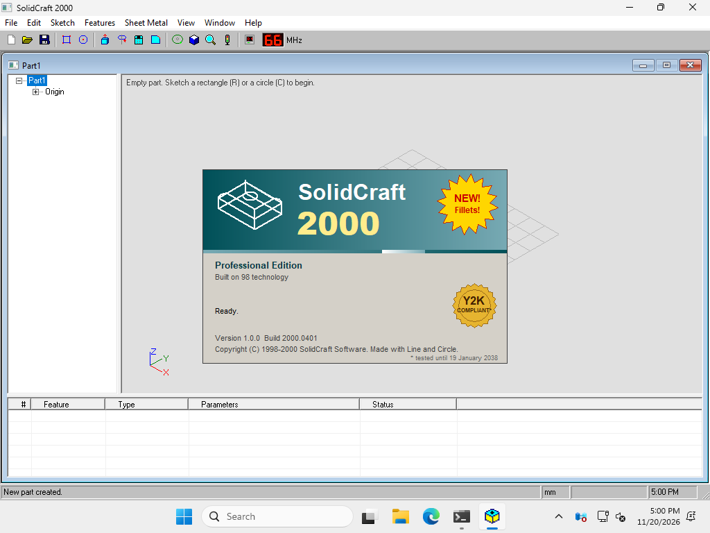

SolidCraft 2000 is the sequel to [SolidCraft 98](https://github.com/raykholo/solidcraft98),
written the way it would have been written in 2000: the same Visual Basic,
the same MDI window, `TreeView` and `ListView`, and a wireframe drawn with
`Line`, one edge at a time. Now in grey-teal, with every new idea of the year
2000 in it, good and bad.

It's a joke, but it works. Everything SolidCraft 98 does, it does: sketch,
extrude, revolve, drill holes, change any feature later, open designs from
SolidCraft itself, and export STL for a 3D printer. And it opens SolidCraft 98
parts.

> **SolidCraft 2000 is a parody.** It is not affiliated with, endorsed by, or a
> replacement for SolidCraft, and it shares no code with it.

Requested by the SolidCraft Discord, which has been asking for SolidCraft
2000 since SolidCraft 98 first said a feature "requires SolidCraft 2000",
and by brett19, who asked that it blue-screen every 15 minutes or so. It does.

**Talk about it** on the [Dutchman CAD Discord](https://discord.gg/yTcseBEdeu).

## Getting it

Download it from the [latest release](https://github.com/raykholo/solidcraft2000/releases/latest):
`SolidCraft2000-1.2.zip`. Unzip it anywhere and run `SolidCraft2000.exe`. One
EXE, nothing to install, like SolidCraft 98. It runs on Windows 10 and 11. The
EXE isn't signed, so Windows may say it "protected your PC": choose More info,
then Run anyway.

The release also has `SolidCraft2000-1.2-floppy.img`, the whole thing on one
1.44 MB floppy disk, and `SHA256SUMS.txt`. Every build on the
[Actions tab](https://github.com/raykholo/solidcraft2000/actions) keeps its EXE
too (artifact `exe`), for the newest one between releases.

Like SolidCraft 98, it still fits on one floppy, packed with UPX.

## Other editions

SolidCraft 98 came in other editions, so SolidCraft 2000 does too: the same
parts, the same `.sc2` and `.sc98` files byte for byte, in two more languages
from the period (or near enough). Both are on the
[Releases page](https://github.com/raykholo/solidcraft2000/releases/latest) next
to the Windows version, with `SHA256SUMS-editions.txt`. New in 1.2.

| Edition | Runs on | Written in | Download |
|---|---|---|---|
| [Delphi Edition](delphi/) | Windows, ReactOS, Linux, Raspberry Pi | Object Pascal (Free Pascal and Lazarus) | `SolidCraft2000-Delphi-1.2.zip` |
| [Linux and Raspberry Pi](freebasic/) | Linux, and a Raspberry Pi from 2014 (ARMv6) | FreeBASIC, every pixel drawn by hand | `SolidCraft2000-Linux-1.2.tar.gz` |

Each edition's README says what it can't do yet, the 2000 way.

The [Embedded Edition preview](rust/) is SolidCraft 2000 in Rust, `no_std`,
for small screens: it reads and writes `.sc2` files, fillets and chamfers
included, and shows a part at 640 x 480 or 320 x 240. It doesn't edit yet.

## New in Service Pack 1

SolidCraft 2000 Service Pack 1 is the "SolidCraft XP, maybe" list from the
[roadmap](ROADMAP.md), all of it, released as 1.1 the day after 1.0. As was
the custom.

### Chamfers

**Features > Chamfer** (M, or the button next to Fillet) cuts every top edge
of an extrude off at 45 degrees: the one picked in the tree or the timeline,
or the last one. Type the distance.

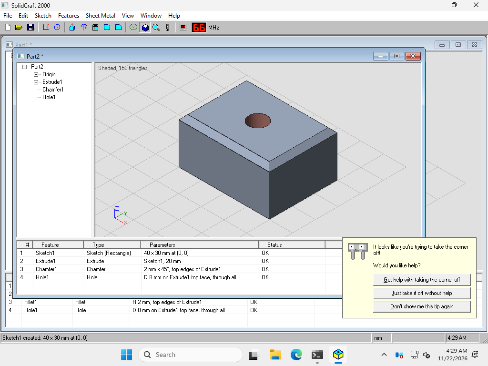

- It works like a fillet: parametric, in the wireframe, the shaded view and
  the STL, and holes keep clear of the slope.
- An extrude gets a fillet or a chamfer, not both. Chamfer something that's
  filleted and SolidCraft 2000 says so.
- 45 degrees only. Other angles, SolidCraft XP.

### Hole patterns

The Hole dialog (H) has four more boxes. **Count** is how many holes. With
**Bolt circle dia.** 0 they go in a row from the centre, **Row spacing**
apart, in the direction of **Angle** (0 is along X, 90 along Y). With a bolt
circle diameter they go round the centre, evenly, the first one at Angle.

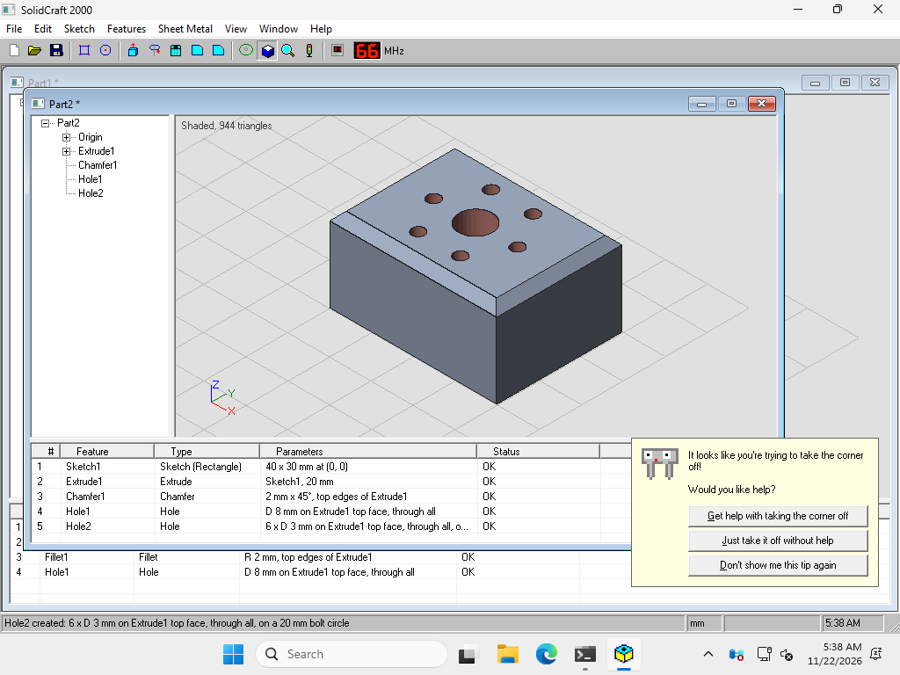

- A pattern is one feature: double-click it to change the count, the
  spacing or the circle, and every hole moves.
- Every hole has to fit on the face and keep clear of the others, the
  fillet or chamfer, and the holes already there. SolidCraft 2000 says which
  rule it broke.
- Up to 36 holes in one pattern. Thirty-six ought to be enough for anybody.

### Chosen edges

The Fillet and Chamfer dialogs have two more boxes: **Top sides** and
**Bottom sides**. Add up the sides you want: 1 front, 2 right, 4 back, 8 left.
15 is all four (the default, at the top), 0 is none (the default, at the
bottom). Front and back is 5. In 2000 this was considered user-friendly.

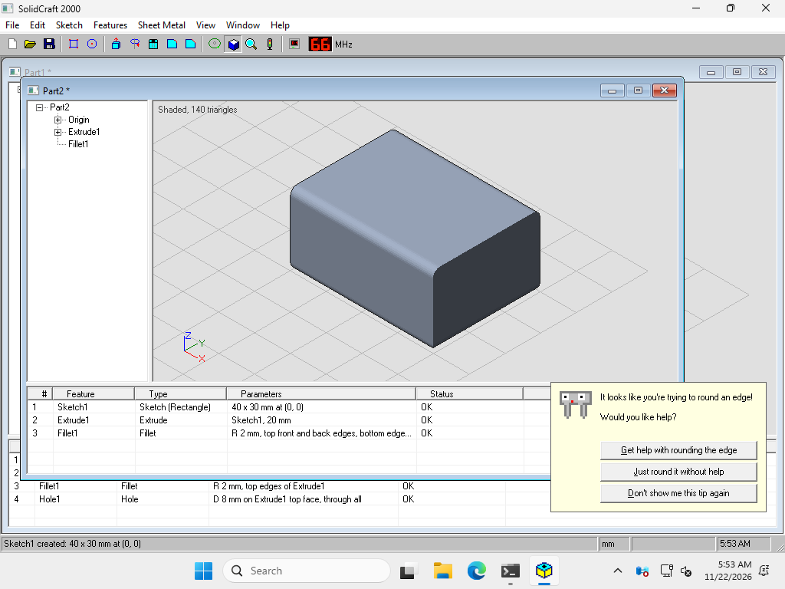

- A sharp-cornered rectangle takes any sides. A circle, or a rectangle with
  rounded corners, is all or nothing (15 or 0), because its edge goes round
  in one piece.
- Top and bottom both: the radius can be at most half the height.
- Holes keep clear of the top fillet, and of the bottom one if they come
  out through it.

### Undo and Redo

**Edit > Undo** (Ctrl+Z) takes back the last change, whatever it was: a new
feature, an edit, a delete, a fold or an unfold. **Edit > Redo** (Ctrl+Y) does
it again. Twenty levels for each part, like Office 2000. The status bar says
what was undone, and "Can't Undo." when there's nothing left. (1.0's Undo
only ever took off the last feature.)

### Fillets and chamfers from SolidCraft designs

File > Open on a SolidCraft design now brings its fillets and chamfers over
too, when they take whole sides of an extrude's top or bottom, as SolidCraft
2000's own do. One on an upright edge, or on part of a circle, still waits in
the timeline for SolidCraft XP. New sample: `Rounded Block.solidcraft`.

### Sketches on side faces

The sketch dialogs have one more box, **Face**. With **On feature #** set to
an extrude, Face 0 is its top, as before, and 1 to 4 are its sides: 1 front,
2 right, 3 back, 4 left. On a side, Corner X runs along the face (left to
right, looking at it), Corner Y goes up it from the extrude's bottom, and
**Height above that** is how far out from it. Extrude the sketch and it grows
out of that side; holes go into its end, fillets round it, and a sketch on
one of its faces works the same way, as far down as you like.

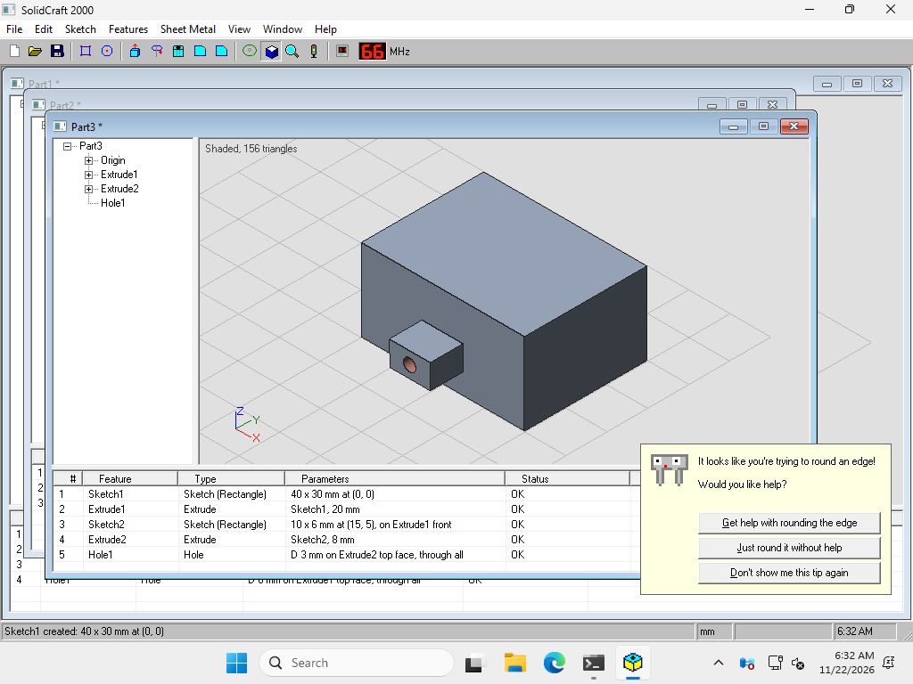

- Only a box has flat sides: a circle's extrude says it's round.
- A body on a side face stays a separate body in the STL, as anything not
  standing on a top face does. Slicers merge them.
- A hole through all goes through the bodies facing the same way, and stops
  at the face.
- Sheet metal lies flat: a base flange needs a sketch on the ground or a top.

### Service Pack 1 parts

A part with a chamfer, a hole pattern, a fillet on chosen edges or a sketch on
a side face is saved as version 7. SolidCraft 2000 1.0 won't open it, and asks
for Service Pack 1, which it was always going to do. Parts without them still
open in 1.0.

## New in 2000

### Fillets

**Features > Fillet** (L, or the new button on the toolbar) rounds every top
edge of an extrude: the one picked in the tree or the timeline, or the last
one. Type the radius. That's it.

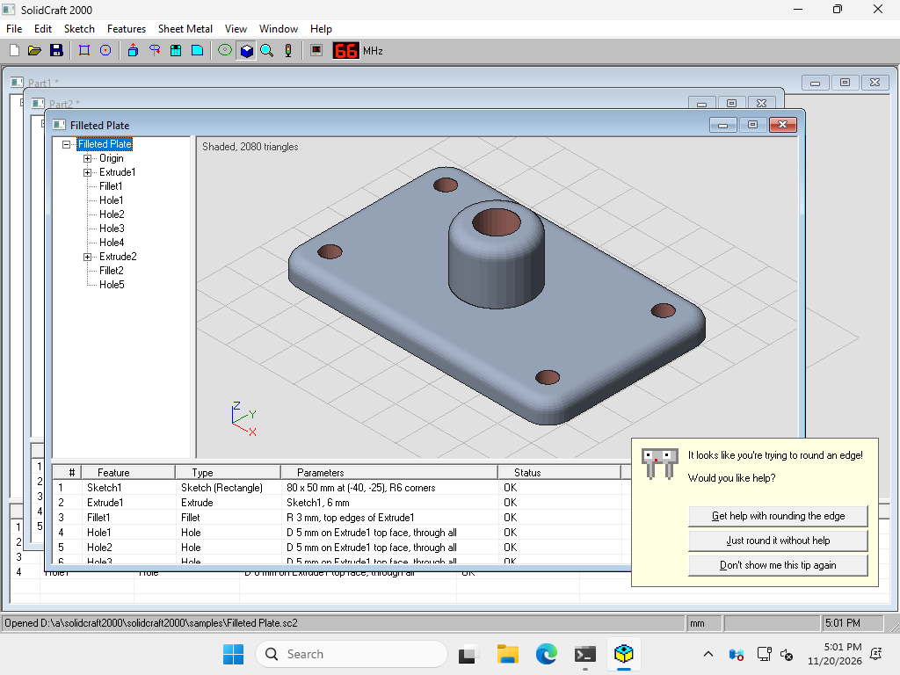

- It's parametric, like everything else: double-click the fillet in the
  timeline to change its radius, or the extrude under it to change that.
- It's in the wireframe, the shaded view and the STL. The rounded edge is
  exact: going up the fillet, the outline shrinks by `r(1 - cos a)`, so a
  rectangle's corners get sharper and a circle gets smaller, as they should.
- Holes keep clear of it: the Hole dialog won't put one in the rounded edge,
  and a fillet too big for the holes already there says which hole is in the
  way.
- One fillet per extrude (or a chamfer). Service Pack 1 lets it choose its
  edges: see [Chosen edges](#chosen-edges). A rectangle's Corner radius still rounds the four
  upright edges.

Cal, the caliper assistant, has learned a second thing: "It looks like you're
trying to round an edge!"

### Sheet metal

The **Sheet Metal** menu: Base Flange, Edge Flange, Flat Pattern and the Bend
Table Wizard. Sketch a rectangle, choose Base Flange, and the Bend Table Wizard
asks for a material and a thickness (with an Advanced... dialog over the
wizard, for the bend radius and K-factor, and an "Are you sure?" over that).
Then add edge flanges, one to an edge, each with its own angle and bend relief.

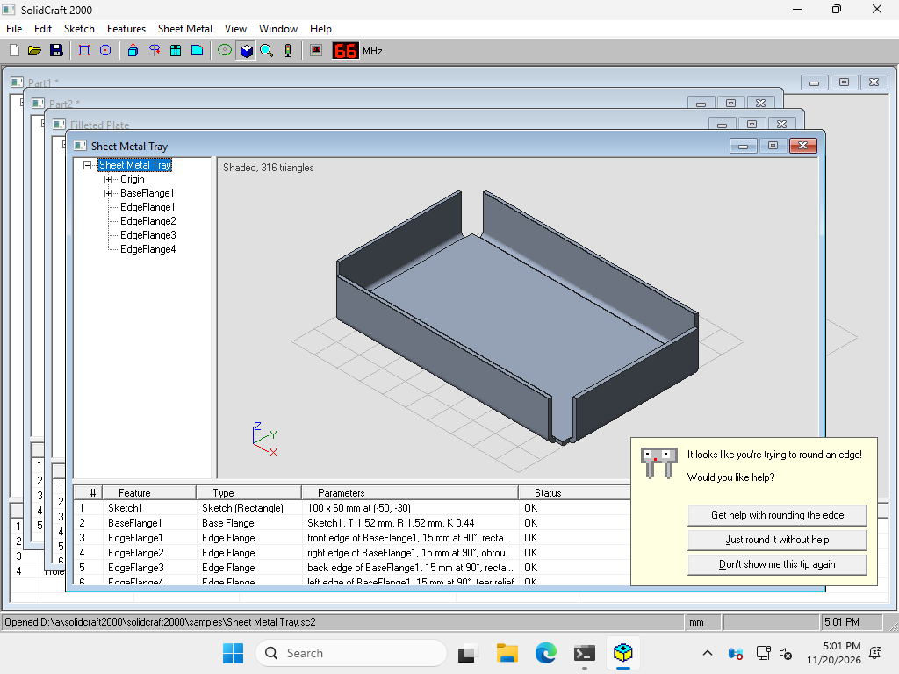

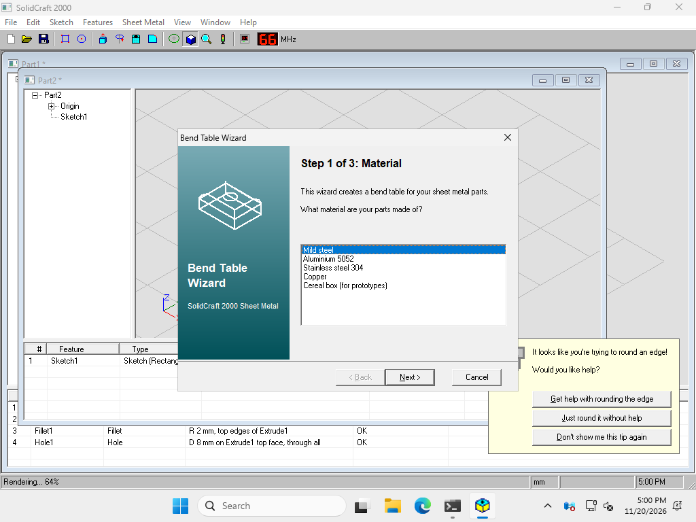

**Flat Pattern** unfolds the part, shows the bend lines in green, and writes a
DXF of the flat blank with its relief cuts, named the 8.3 way
(`PART2~1.DXF`) for the nesting software in the shop. Choose it again to fold
the part back up.

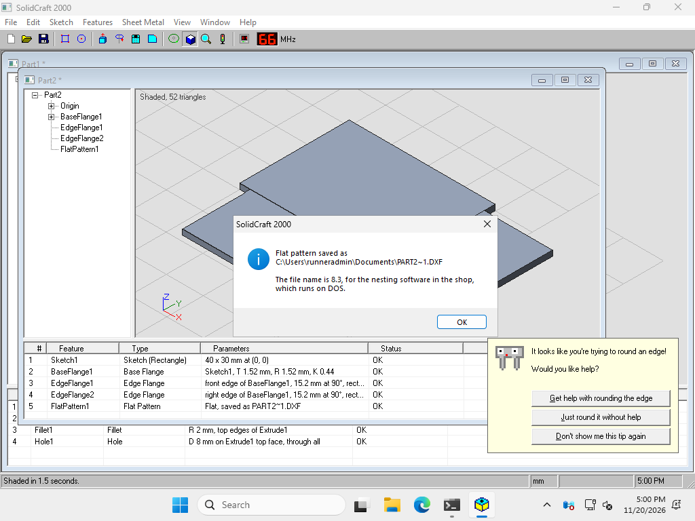

What's there now is a small reference engine. It's a slot: everything sheet
metal is in one module, behind a documented interface, waiting for a real
engine. [CONTRIBUTING-SHEETMETAL.md](CONTRIBUTING-SHEETMETAL.md) says where it
plugs in, how to run it, and what "clunky" means here.

### Personalized Menus

The File, Features and View menus show only what you've used. The rest wait
behind **Show all items** at the bottom, which opens the menu again with
everything in it. Use something and it stays. Keyboard shortcuts of hidden
items don't work, because Windows takes a hidden item's shortcut with it; that
is how it was, and why everybody turned this off. (Nothing is saved: every run
starts short.)

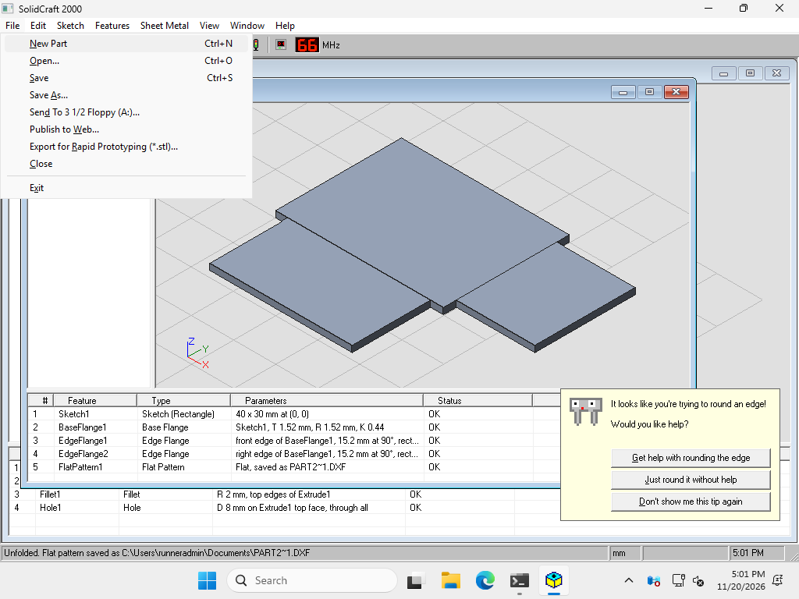

### The Upgrade Wizard

**Help > Upgrade from SolidCraft 98** (or start it with `/UPGRADE`): Welcome,
the licence agreement, Upgrade or Clean install, a Year 2000 compliance check,
and Finish. It changes nothing on your computer. The upgrade that matters
happens when you open an `.sc98` part: it comes in whole, and Save writes it as
a new `.sc2`.

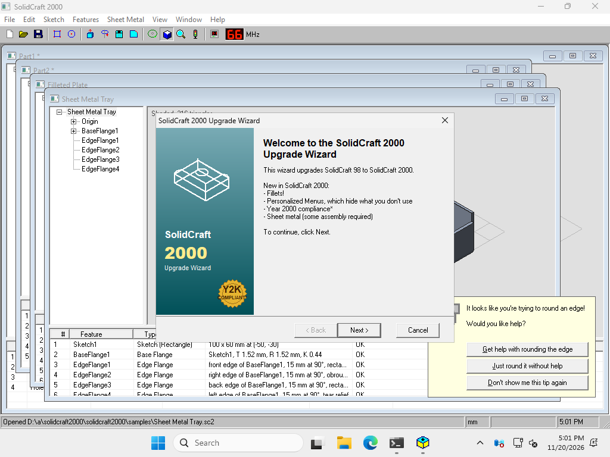

### The Stability Pack

Every 12 to 18 minutes, SolidCraft 2000 blue-screens. It's a picture: any key
closes it, and the part, the timeline and any open dialog are exactly as they
were. Nothing is ever lost.

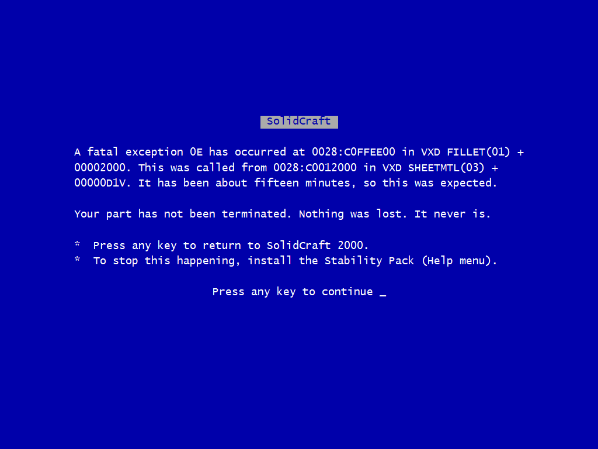

**Help > Install Stability Pack** stops it, and is remembered (one setting, in
the registry key VB's `SaveSetting` uses). It's also off under the remote
control and with `/STABLE`. `/CRASHTEST` brings the first one forward to ten
seconds, to see it without waiting.

### Check Online for Help

**Help > Check Online for Help...** dials SolidCraft Online, with the noise:
the dial tone, the number in touch tones, the ring, the answer tone, the
"bong", and the screech. Then "Connected at 56,000 bps" (actual speed 28,800
bps; it was always 28,800 bps), and your browser opens this README, which is
all the online help there is. Cancel hangs up. Asked for on the
[Dutchman CAD Discord](https://discord.gg/yTcseBEdeu).

The handshake isn't a recording: `modModem.bas` makes it, sample by sample, at
a volume that won't wake anyone.

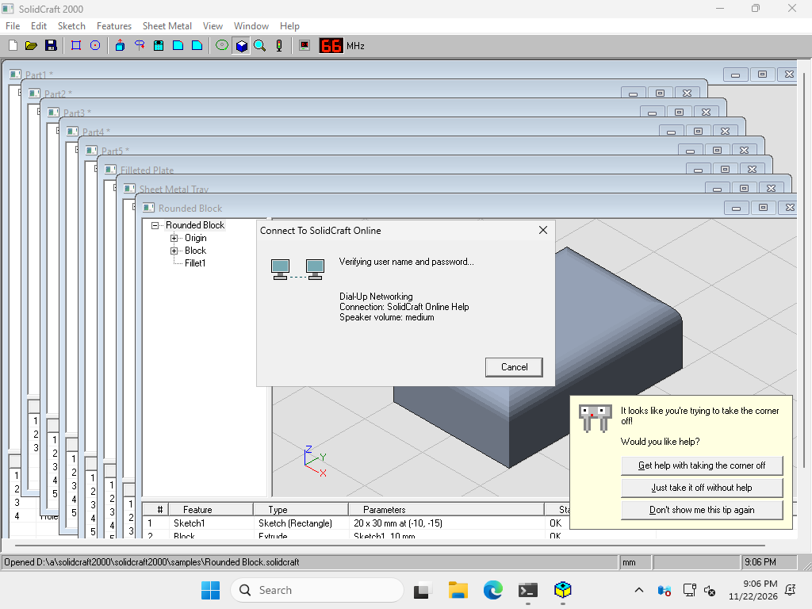

### And

- Parts are `.sc2` files. File > Open still takes `.sc98` parts and SolidCraft
  designs. Two new samples: `Filleted Plate.sc2` and `Sheet Metal Tray.sc2`.
- The splash, the About box and the wizards are grey-teal, with a Y2K
  sticker. The logo's block has filleted edges.
- The demo-scene credits (type WIN98 in the About box) have new lines.

## Design a part with a fillet

A mounting plate with a rounded top edge: 80 x 50 x 6 mm, a hole in each
corner, and a boss with a bore. About five minutes.

1. **The plate outline.** Press R. Width 80, Height 50, Corner X -40, Corner
   Y -25, Corner radius 6. OK.
2. **The plate.** Press E. Depth 6. OK.
3. **The fillet.** Press L. Radius 2. OK. The top edge of the plate is round,
   and so are its corners.
4. **Corner holes.** Press H. Diameter 5, Depth 0 (all the way through),
   Centre X -32, Centre Y -17. OK. Again at (32, -17), (32, 17) and (-32, 17).
   (With Service Pack 1, two rows of two do it: Count 2, Row spacing 64.)
5. **The boss.** Press C: Radius 10, Centre 0, 0, on feature # 2 (the plate).
   OK. Press E: Depth 15. OK. Press L: Radius 3. OK.
6. **The bore.** Press H. Diameter 10, Depth 0, Centre 0, 0. It goes through
   the boss and the plate.
7. **Change your mind.** Double-click Fillet1 and make it 5. SolidCraft 2000
   says Hole1 is too close to the edge for that. Make it 3.
8. **Shade it** with S, and **print it** with File > Export for Rapid
   Prototyping (Show all items first: it's hidden until you've used it).

## What it can't do yet

- Sketches are rectangles and circles, on the ground, a top face or the side
  of a box. Holes go straight in from a body's top (or end) face, one at a
  time, in a row or round a circle. Fillets and
  chamfers go on whole sides of an extrude's top and bottom, not on its
  upright edges (a rectangle's Corner radius does those).
- No booleans to speak of: a body standing wholly on another's top face is
  joined to it in an STL; anything else stays separate (slicers merge them).
- Sheet metal is the reference engine: see its limits in
  [CONTRIBUTING-SHEETMETAL.md](CONTRIBUTING-SHEETMETAL.md).
- Export is STL, and DXF for flat patterns. Parts save as `.sc2`.

## Keys

| Key | Command |
|---|---|
| Ctrl+N / Ctrl+O / Ctrl+S | New, Open, Save |
| Ctrl+Z / Ctrl+Y | Undo, Redo |
| R, C | Sketch rectangle, sketch circle |
| E, V, H, L, M | Extrude, Revolve, Hole, Fillet, Chamfer |
| I, F | Isometric view, Zoom to fit |
| S | Shaded (again for wireframe) |
| Enter, or double-click | Edit the selected feature |
| Del | Delete the selected feature |
| + / - | Zoom in and out |
| F5 | Regenerate |
| F1 | Help (it isn't installed) |

Turbo, Cal's pin, the floppies, Publish to Web, DLL Hell and the Y2K bug are
all still in there. [SolidCraft 98's README](https://github.com/raykholo/solidcraft98#turbo)
has the spoilers.

## Remote control

Start it with `/REMOTE` and SolidCraft 2000 listens on TCP port 9898, as
SolidCraft 98 does, and takes the same commands: `look`, `click`, `menu`,
`key`, `type`, `how`, `yes` and the rest. It reads the new things out too: the
Sheet Metal menu, the wizards and their lists, and the blue screen. Plain
`/REMOTE` takes connections from this PC only; `/REMOTE:ANY` from any
computer, so use that only on a network you trust.

The personalized menus apply to the remote control as well: "menu File > Save
As..." answers that the File menu has no Save As, and lists what it does have,
including Show all items. CI drives the program this way on every push
(`tools/ci/smoke.py`).

## Source

The source is plain VB6 text: `src/SolidCraft2000.vbp` plus `.frm` and `.bas`
files. There are no `.frx` files: the icons, the logo and the splash are
drawn at startup. New in 2000:

| File | What it does |
|---|---|
| `modKernel.bas` | Fillets and chamfers: `InsetSketch`, `EdgeAt`, `FilletOf`, `TopFace`, and the rounded wireframe |
| `modMesh.bas` | Fillets and chamfers in the solid: rings of the outline moved in, up the quarter circle or the slope |
| `modSheetMetal.bas` | Sheet metal: the slot and its reference engine |
| `frmBendTable.frm` | The Bend Table Wizard |
| `modAdaptive.bas` | Personalized Menus |
| `frmUpgrade.frm` | The Upgrade Wizard |
| `modStability.bas` | The blue screen every 15 minutes or so, and the Stability Pack |
| `frmModem.frm`, `modModem.bas` | Check Online for Help, and the modem handshake, made in code |
| `modArt.bas` | The 2000 logo, the starburst and the Y2K sticker, in `Line`, `Circle` and GDI |

The rest is SolidCraft 98's, described in
[its README](https://github.com/raykholo/solidcraft98#source).

## Building from source

**With twinBASIC** (free, and what CI builds with), on Windows with Python 3:

```
python tools/vb2tb.py src/SolidCraft2000.vbp build/src
python tools/impexp.py import build/SolidCraft2000.twinproj build/src --overwrite
twinBASIC.exe build\SolidCraft2000.twinproj --buildAndExit32
```

The EXE lands in `build\Build\SolidCraft2000.exe`. If the build hits a compile
error the IDE stays open in the background: open the `.twinproj` in the IDE to
see it.

**On GitHub**, every push builds on a Windows runner (`.github/workflows/build.yml`,
which runs `tools/ci/build.ps1`), fails if the UPX-packed EXE no longer fits
on a floppy, and then runs the smoke test, keeping its screenshots. A `v*` tag
publishes the zip and the floppy image as a release.

## Licence

MIT. See [LICENSE](LICENSE) and [NOTICE](NOTICE). The EXE is compiled with
twinBASIC, which is not part of this project.

SolidCraft 2000 is a parody, and not affiliated with or a replacement for
SolidCraft.
