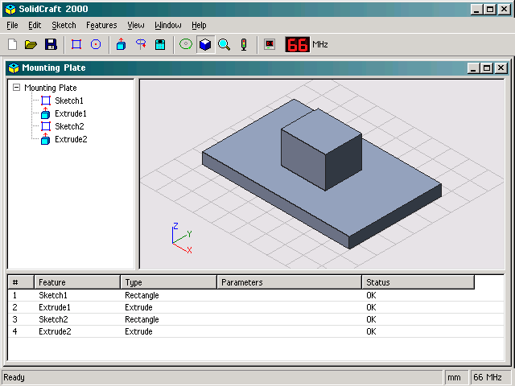
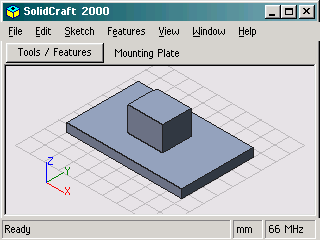
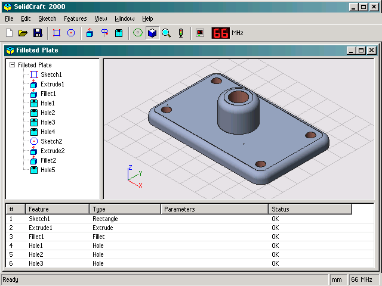

# SolidCraft 2000: Embedded Edition (preview)

> **SolidCraft 2000 is a parody.** It is not affiliated with, endorsed by, or a
> replacement for SolidCraft, and it shares no code with it. Neither is
> SolidCraft 98, whose Embedded Edition this grew out of.

The same joke as [SolidCraft 2000](../README.md), in Rust, for a computer that
costs less than the floppy disk: a small `no_std` core, the grey-teal desktop
drawn by hand into a framebuffer, a desktop window for trying it out, and a
screen that is any terminal on the far end of a USB cable. Version 1.2.

It is a **preview**. It does about half of what SolidCraft 2000 does, and it
will say so.





## What it does

- **Opens SolidCraft 2000 parts** (`.sc2`, format versions 3 to 7, Service Pack
  1 included) and SolidCraft 98 parts (`.sc98`), and saves both back byte for
  byte. Try `samples/Filleted Plate.sc2`.
- **Builds them**: sketches (rectangle with corner radii, circle), extrude,
  revolve, through and blind holes, and the new thing, **fillets and
  chamfers**: every top edge, the bottom edges, or chosen sides of a
  rectangle, exactly as SolidCraft 2000 rounds them. Wireframe, shaded, and STL.
- **Opens SolidCraft designs** (`.solidcraft`), as far as SolidCraft 98 could
  (build with the `import` feature).
- **Draws it** at 640 x 480 or 320 x 240, in 16 bit colour or the 16 colours
  of the day, with depth buffer or painter's algorithm, in a window, to a PNG,
  or as ANSI text.

## What it doesn't do yet

- **Hole patterns**, **sketches on side faces**, **sheet metal**, **Undo**,
  **parameters** and **the Stability Pack**. A part that uses them opens and
  saves unchanged, and the timeline marks what can't be built.
- **Editing in the window.** The desktop shows a part (`--open FILE`, or the
  mounting plate) and returns the commands you click to its host. It does not
  yet save, or change a dimension. File commands say "No disk in drive A:." It
  is authentic.
- **Blue-screening every 15 minutes.** It does not crash. Ask again in 1.3.

| Crate | What it is |
|---|---|
| `sc2000-core` | Parts, features (sketch, extrude, revolve, hole, fillet, chamfer), editing and rebuild, `.sc2` and `.sc98` files byte for byte, meshes and STL. `no_std`. |
| `sc2000-pixels` | The SolidCraft 2000 look drawn by hand into a framebuffer: font, icons, widgets, the 3D view (wireframe and shaded). `no_std`. |
| `sc2000-desktop` | A desktop window showing the classic 640 x 480 or compact 320 x 240 layout, and the adapter that shows a core part. |
| `sc2000-term` | The screen as ANSI terminal output (half-blocks for shaded, Braille dots for wireframe), only changed cells sent, keys and mouse back. `no_std`. |
| `sc2000-term-demo` | The terminal screen in a PC terminal, no microcontroller needed. |

The core's own notes are in [`sc2000-core/README.md`](sc2000-core/README.md).
CI ([`rust.yml`](../.github/workflows/rust.yml)) checks formatting, the core
without `std`, the tests, clippy, and RISC-V builds with their sizes.

## Pixels: try it

From `rust/`:

```sh
cargo run -p sc2000-desktop --release
cargo run -p sc2000-desktop --release -- --compact
cargo run -p sc2000-desktop --release -- --compact --painter --indexed
cargo run -p sc2000-desktop --release -- --open "../samples/Filleted Plate.sc2"
```

Drag with the left mouse button to orbit; right-drag to pan. The wheel,
`+` and `-` zoom. `S` switches shaded/wireframe, `I` restores isometric,
`F` fits the part. Click menus or use Alt+F/E/S/T/V/W/H, arrows and Enter.
`Tab` opens the compact Tools / Features drawer; Escape closes it. Up/Down
select a feature; Enter opens its number dialog. Number dialogs accept
numeric input, Backspace, Tab, Enter and Escape. Large compact dialogs have
three fields per page; **More fields >** and Tab reach every field.

With no `--open` the demo is a small mounting plate with a rectangular boss.
`--open` takes a `.sc2` or `.sc98` part and shows it through `CorePart`, the
adapter from `sc2000-core` to `sc2000-pixels`. Saving, and editing a feature,
await the host: the UI returns commands and accepted parameters to it. The
desktop never writes designs, and its File commands display a message box.

## Pixels: drawing and integration

`sc2000-pixels` is `no_std`, forbids unsafe code, and uses no heap. Its only
dependency is `libm`. Font widths, all 256 glyphs and all 17 icons are const
ports of the FreeBASIC artwork of SolidCraft 98, reproduced by
`python3 tools/port-art.py` (the checked-in copies the test compares to are in
`sc2000-pixels/tests/fixtures/`). The SolidCraft 2000 colours (a warmer grey face, grey-teal where
SolidCraft 98 was navy, the art's light grey following the face), six bevel styles, dotted tree connectors,
title gradients, menus, toolbar, MHz display, buttons, tree, timeline,
status bar, message boxes and number dialogs follow the FreeBASIC edition.
RGB565 quantization and the compact arrangement necessarily change some
pixels; these goldens establish this port's baseline, not cross-language
pixel equivalence.

Implement `model::Part` for a core adapter: a borrowed name, a slice of
`Feature { name, kind }`, and a slice of `Triangle { vertices, normal,
color, face }`. Geometry uses the single `Scalar = f32` alias. Units are
millimetres; Z points up. Normals point out. Triangles on one surface share
a nonzero face ID; distinct surfaces have distinct IDs. This suppresses
coplanar wireframe diagonals and draws shaded face boundaries. `DemoPart`
is an independent const-data adapter for bring-up and tests. The graphics
crate doesn't depend on the model crate: any type implementing `Part` works.

Implement `framebuffer::Framebuffer` (`width`, `height`, `set`; overridable
`fill` and RGB565 `blit`) for a display driver, or borrow a slice through
`Rgb565` / `Indexed16`. Indexed pixels use one byte each, with the reference
QB 16-colour palette. Arbitrary RGB565 colours are mapped to their nearest
palette entry. Coordinates and Canvas clips stay inside the framebuffer.
No unsafe framebuffer boundary is needed for these memory backends.

`App::new(layout, part)`, `App::event` and `App::render` share layout and hit
testing between hosts. `Action::Command` identifies commands and
`Action::Parameters` carries the accepted numeric fields. The host owns
model mutation, file dialogs and expression evaluation. Window decorations
are drawn; OS-style MDI dragging, resizing and multiple documents are outside
this demo. `sc2000-desktop` uses minifb's X11 backend and a persistent buffer;
no toolkit paints any controls.

The view uses the reference orthographic projection (135° yaw, 35.264°
pitch), 10 mm grid, axis triad and viewer-relative flat lighting. Select
`Visibility::Depth` for interpolated per-pixel depth plus face IDs, or
`Visibility::Painter` for centroid sorting without a depth buffer. Painter
sorting is approximate for intersecting triangles. Degenerate, non-finite
and extreme projected triangles are skipped. Wireframe needs no scratch
memory. Caller-owned scratch requirements are:

| Storage | Bytes |
|---|---:|
| 320 × 240 RGB565 framebuffer | 153,600 |
| 320 × 240 indexed framebuffer | 76,800 |
| Depth + face IDs | viewport width × height × 6 |
| Painter order for 300 triangles | 1,200 on RV32; 2,400 on this PC |

The desktop allocates depth buffers only in depth mode, and an indexed
buffer only in indexed mode. The renderer itself does not allocate. See
[validation and measurements](docs/validation.md) for this machine's results.

## Pixels: checks and screenshots

Test one crate at a time:

```sh
cargo test -p sc2000-pixels --test graphics
cargo clippy -p sc2000-pixels --all-targets -- -D warnings
cargo test -p sc2000-desktop --test render
cargo clippy -p sc2000-desktop --all-targets -- -D warnings
cargo fmt --all --check
```

Seven checked-in little-endian RGB565 buffers cover the artwork, controls,
number and message dialogs, and depth/painter/wireframe views. Tests also
check clipping, palette conversion, short buffers, non-finite meshes,
intersecting surfaces, menu dispatch, drawer controls and all seven numeric
fields in both layouts. Desktop tests decode and compare the two PNGs,
exercise modal/drawer rendering and indexed output, and time a distinct
300-triangle cylinder (100 top triangles and 200 wall triangles).

Only regenerate baselines after reviewing the pixels:

```sh
UPDATE_GOLDENS=1 cargo test -p sc2000-pixels --test graphics
UPDATE_SCREENSHOTS=1 cargo test -p sc2000-desktop --test render screenshots_and_colour_modes
cargo run -p sc2000-desktop --release -- --screenshot docs/desktop-640x480.png
cargo run -p sc2000-desktop --release -- --compact --screenshot docs/desktop-320x240.png
cargo run -p sc2000-desktop --release -- --benchmark
```

Screenshots render the actual framebuffer to PNG without an X server. For
a window smoke check, use `xvfb-run -a` on the built executable with
`--frames 3` (repeat with `--compact`).

For a bare-metal release and a linked size probe:

```sh
rustup target add riscv32imc-unknown-none-elf
cargo build -p sc2000-pixels --release --target riscv32imc-unknown-none-elf
cargo build -p sc2000-pixels --example pixels_size_probe --release --target riscv32imc-unknown-none-elf
size target/riscv32imc-unknown-none-elf/release/examples/size_probe
```

`pixels_size_probe` retains both layouts and framebuffer formats. It is a link-size
probe, not startup code or a board support package: its large local buffers
need a host-provided stack. A library `.rlib` archive size includes Rust
metadata and bitcode and is not a firmware flash-size estimate.

The first screen is the computer at the other end of the USB cable. Open a
UTF-8 ANSI terminal on the serial port: the board sends the picture and the
terminal sends keys and mouse reports back. No companion program is needed.

This part supplies the terminal transport and a PC demonstration. The model,
The demonstration draws its own test card and cube; wiring it to `sc2000-core` and `sc2000-pixels` is the next step.

## Terminal screen: try it

From the repository root:

```sh
cargo build --manifest-path rust/Cargo.toml --release -p sc2000-term-demo
```

Run the resulting `sc2000-term-demo` binary in a terminal. Cargo puts the binary under `rust/target/release/`. With an
ordinary checkout outside the shared build environment, `cargo run --release
--manifest-path rust/Cargo.toml -p sc2000-term-demo` also launches it.

Options: `--wireframe`, `--pattern`, `--256`, `--16`, `--box`, `--help`.
True colour and nearest-neighbour sampling are the defaults. `--measure`
prints deterministic byte counts without entering raw mode. It measures both
display modes and all three colour choices.

Ctrl-Q exits and restores the screen, cursor, mouse modes, wrapping and raw
mode. S switches shading, P switches the test card, B switches filtering,
Space pauses, Left/Right turns the cube, mouse drag turns it and the wheel
zooms. Ctrl-L redraws. Native size changes are polled every 250 ms; startup
also sends a cursor-position probe. The demo supports up to 320x120 cells.

## Terminal screen: board integration

`sc2000-term` is `no_std`, has no dependencies and uses no allocation or unsafe
code. Supply a tightly packed framebuffer slice, dimensions and a `Write`
adapter whose `write_all` sends every byte or returns an error. A slice of
`u16` is RGB565; `Rgb` is RGB888; `Palette16` indexes the conventional ANSI
palette. Implement the small `Pixel` trait for another pixel representation
or palette order. There is no dependency on a particular framebuffer library.

```rust
use sc2000_term::{Cell, Config, Encoder, Frame, Size, Write};

fn picture<W: Write>(serial: &mut W, pixels: &[u16; 8]) -> Result<(), W::Error> {
    // Keep this array and Encoder alive between frames. An embedded application
    // can place the array in its static memory using its normal safe allocator.
    let mut previous = [Cell::EMPTY; 1];
    let mut encoder = match Encoder::new(
        &mut previous, Size { cols: 1, rows: 1 }, Config::default(),
    ) {
        Ok(encoder) => encoder,
        Err(_) => return Ok(()),
    };
    if let Ok(frame) = Frame::new(pixels, 2, 4) {
        encoder.render(&frame, serial)?;
    }
    Ok(())
}
```

Send `ENTER` once and `EXIT` on exit, including error exits. These enter an
alternate screen, hide the cursor, disable wrapping (including at the bottom
right), and enable mouse modes 1000, 1002 and 1006. They restore those modes
on exit. They assume the usual initial state: mouse off, cursor visible,
wrapping on. Buffer small writes in the serial adapter if that is cheaper
than sending them individually. After a transport error the encoder marks
the whole screen dirty and resets its attribute cache for a complete retry.

Send `SIZE_PROBE` and feed the reply through `Decoder`; forward `Event::Size`
to `Encoder::handle_event`. If no reply arrives, use `Size::default()`:
160x60. Resize validates the previous-cell buffer capacity before changing
state. Allocate a larger buffer if larger terminals are supported; a rejected
resize leaves the old dimensions intact. `handle_event` also handles Ctrl-L.
Use `redraw()` after any external screen writes or reconnect, and `configure()`
to change display mode, palette or sampling.

`Decoder::feed` accepts arbitrary fragments, including UTF-8. It calls a
callback for each event, so no event queue is allocated. Escape is inherently
ambiguous with an escape-sequence prefix: call `escape_timeout()` after an
idle interval (the demo uses 60 ms) to emit a lone Escape. It retains partial
CSI/SS3/UTF-8 sequences across that timeout. `reset()` explicitly cancels an
unfinished sequence. Oversized or unsupported sequences are discarded through
their final byte. Mouse coordinates are zero-based terminal cells; a viewport
adapter must map them to its own pixels. Supported keys include printable
Unicode, control keys, Alt characters, arrows/navigation, F1–F12 using CSI
tilde or CSI/SS3 letter forms, and xterm modifier parameters. Two-parameter
CSI `R` is interpreted as a cursor-position reply; use SS3 F3 if a terminal
otherwise sends the same bytes for modified F3.

Shaded cells use `▀`, with top pixel foreground and bottom pixel background.
Braille uses the standard 2x4 dot order, sets dots for pixels different from
`wire_background` and averages the lit pixels into one foreground colour.
Black is the default wire background; white backgrounds and black lines are
supported too. Braille conveys line coverage, not eight independent colours.

The framebuffer fits the terminal's pixel raster while preserving aspect
ratio and centring unused space. Each terminal cell has physical aspect 1:2:
the raster is cols x (2*rows) for shaded and (2*cols) x (4*rows) for Braille.
Nearest sampling maps integer source coordinates. `Box2x2` averages a clamped
2x2 source neighbourhood at each mapped coordinate; it is a cheap filter,
not a full area resampler. Use a framebuffer near the destination size to
keep very thin wireframe lines when reducing the image.

Colour selection happens at startup/configuration, with nearest RGB distance
to the conventional xterm 256-colour or ANSI 16-colour palette. Terminal
themes may change the actual first 16 colours. Cells store the quantized
result, so invisible changes in a reduced palette send no bytes. Contiguous
changed cells share cursor positioning and attributes; unchanged frames emit
zero bytes. Full redraws clear the screen, including old resize margins.

Previous-frame storage costs 12 bytes/cell: **115,200 bytes at 160x60**, plus
the caller's framebuffer and a small encoder/decoder. Use fewer cells on a
smaller board. The encoder never keeps a second framebuffer or cell array.

## Terminal screen: checks and measurements

Run checks one crate at a time:

```sh
cargo test --manifest-path rust/Cargo.toml -p sc2000-term --test terminal
cargo test --manifest-path rust/Cargo.toml -p sc2000-term-demo --test scene
cargo clippy --manifest-path rust/Cargo.toml -p sc2000-term --all-targets --all-features -- -D warnings
cargo clippy --manifest-path rust/Cargo.toml -p sc2000-term-demo --all-targets -- -D warnings
cargo fmt --manifest-path rust/Cargo.toml --all --check
```

CI runs the complete workspace on every push, along with a release cross-build.
`tools/terminal_smoke.py /path/to/sc2000-term-demo` exercises a real Unix PTY:
startup, split probe reply, Ctrl-L, resize, display mode change, mouse input,
Ctrl-Q and exact restoration of termios state in six configurations.

For a linked size fixture, install the `riscv32imc-unknown-none-elf` Rust
target and run:

```sh
cargo build --manifest-path rust/Cargo.toml --release -p sc2000-term --target riscv32imc-unknown-none-elf
cargo build --manifest-path rust/Cargo.toml --release -p sc2000-term --features size-probe --example term_size_probe --target riscv32imc-unknown-none-elf
```

The fixture retains the encoder (both modes, all palettes), input decoder,
RGB565, filtering, diffing and resize through `black_box`. It is for size
measurement, without board startup or a real serial driver. It places the
previous cells on the stack, so it is not ready-to-flash board firmware.
See [MEASUREMENTS.md](MEASUREMENTS.md) for measured flash/storage and wire costs.
